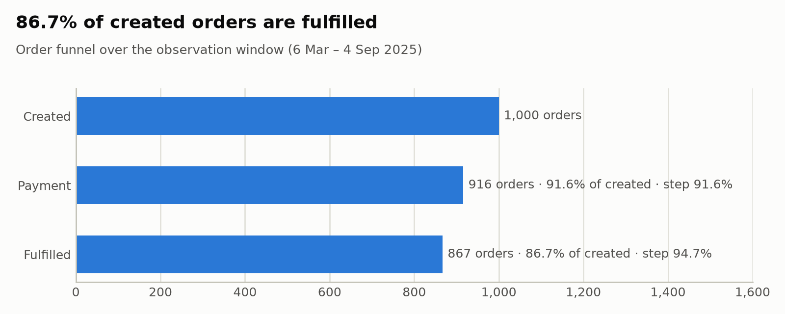
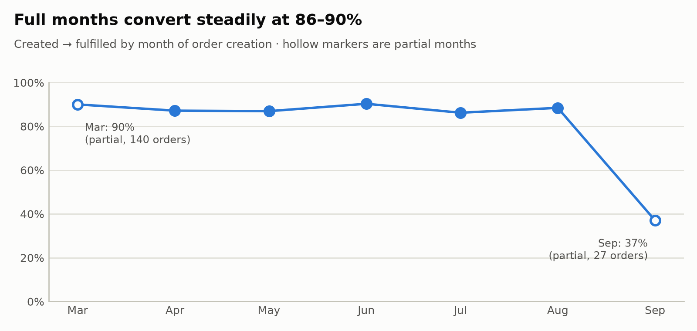
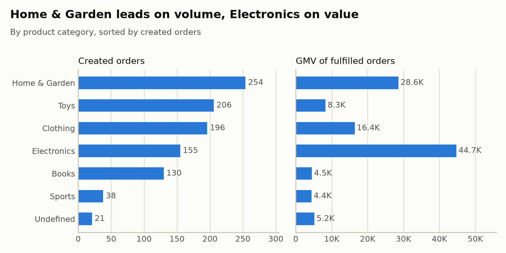
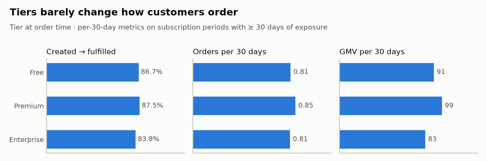
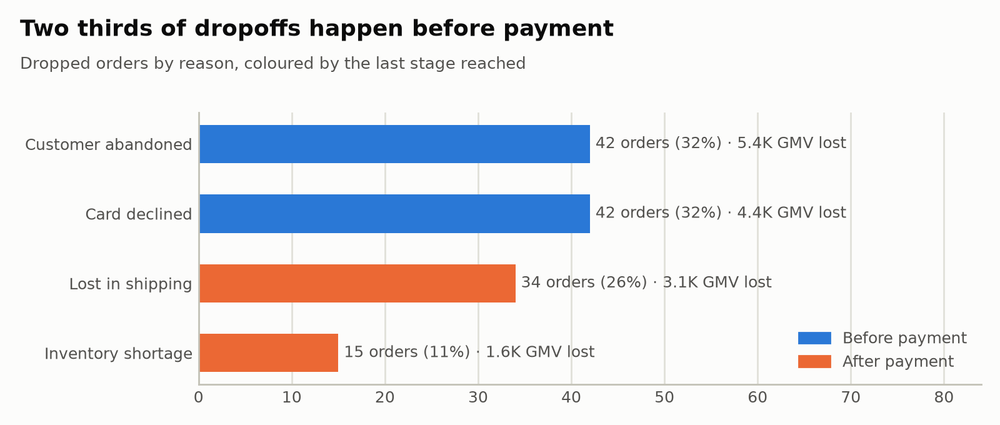
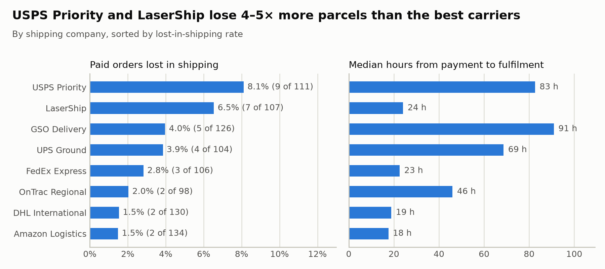

# Order funnel insights

Analysis of 1,000 orders created between 6 March and 4 September 2025 by 200
customers. Every number below comes from a query in [`analyses/`](../analyses)
that reads the mart layer; the charts are rendered from the same queries by
[`scripts/insights_charts.py`](../scripts/insights_charts.py).

## Executive summary

- **86.7% of created orders are fulfilled.** 8.4% are lost before payment and a
  further 5.3% of paid orders are lost after it. Conversion is flat at 86–90% in
  every full month.
- **Card declines cause 32% of all dropoffs** (42 orders, 4.2% of created
  orders), level with customers abandoning checkout. Together they make up two
  thirds of the losses.
- **Lost GMV is 14.5K**, about 11% of the 126.6K that the created orders were
  worth. Fulfilled GMV is 112.2K.
- **Carrier choice matters more than tier.** USPS Priority loses 8.1% of paid
  orders in shipping and Amazon Logistics 1.5%. The gap between subscription
  tiers is under 5 percentage points on every metric.
- **Home & Garden has the most orders, Electronics the most value**: 254 orders
  against 155, but 44.7K of GMV against 28.6K.

## 1. Conversion from creation to fulfillment

Queries: `q1_conversion_overall.sql`, `q1_conversion_by_cohort.sql` on
`mart.order_funnel`.

| Step | Orders | Step conversion | Cumulative conversion |
|---|---:|---:|---:|
| Created | 1,000 | – | – |
| Payment | 916 | 91.6% | 91.6% |
| Fulfilled | 867 | 94.7% | 86.7% |

The payment step loses more orders than fulfilment: 84 orders against 49.

Monthly cohorts from April to August convert between 86.2% and 90.3%, with no
trend. The two partial months at the edges of the window need a caveat:

- **March (from the 6th, 140 orders) converts at 90%**, in line with the rest.
- **September (to the 4th, 27 orders) converts at 37%.** All 27 orders have
  reached a final state (no order is still in progress), and the 17 dropoffs are
  spread over all four reasons: 6 card declines, 5 abandonments, 5 lost in
  shipping, 1 inventory shortage. With no single cause and only four days of
  data, I read this as noise or an artefact of how the extract was cut, not as
  an incident. It is the first thing I would check with the data owner.

## 2. Product categories by order volume

Query: `q2_category_volumes.sql` on `mart.category_performance`.

| Category | Created orders | Fulfilment rate | GMV | Lost GMV |
|---|---:|---:|---:|---:|
| Home & Garden | 254 | 89.4% | 28.6K | 3.1K |
| Toys | 206 | 84.0% | 8.3K | 1.4K |
| Clothing | 196 | 81.1% | 16.4K | 3.9K |
| Electronics | 155 | 91.0% | 44.7K | 5.0K |
| Books | 130 | 87.7% | 4.5K | 0.6K |
| Sports | 38 | 89.5% | 4.4K | 0.4K |
| Undefined | 21 | 90.5% | 5.2K | 0.1K |

- **Home & Garden leads on volume** with a quarter of all orders.
- **Volume and value rank differently.** Electronics is fourth by orders but
  brings 40% of fulfilled GMV, so a lost Electronics order costs about 360 on
  average against 37 for a lost Book.
- **Clothing and Toys convert worst** (81% and 84%). Clothing also loses the
  second-highest value, 3.9K.
- Sports is not among the categories listed in the case-study brief but is in
  the data. Undefined groups two products with no category in the source; they
  are worth 5.2K of GMV, enough to be worth fixing upstream.

## 3. Effect of subscription tiers on customer behaviour

Query: `q3_tier_behavior.sql` on `mart.tier_behavior`.

Each order is assigned the tier the customer held **when the order was
created**, not the current tier. Rates per 30 days divide orders and GMV by the
days each subscription period overlaps the observation window, and only use
periods with at least 30 days of overlap, so short periods do not distort the
averages.

| Tier | Customers | Orders | Payment rate | Created → fulfilled | Avg order value | Orders / 30 days | GMV / 30 days |
|---|---:|---:|---:|---:|---:|---:|---:|
| Free | 123 | 573 | 92.3% | 86.7% | 128.9 | 0.81 | 90.9 |
| Premium | 68 | 328 | 91.5% | 87.5% | 132.3 | 0.85 | 98.7 |
| Enterprise | 23 | 99 | 87.9% | 83.8% | 122.1 | 0.81 | 82.6 |

**Tiers do not measurably change how customers order.** Premium customers order
slightly more often and spend slightly more, but every gap is within a few
points:

- The largest difference is the enterprise payment rate, 4.4 points below free.
  On 99 orders the standard error of the gap is about 3.5 points, so it is not
  significant.
  It is worth watching because enterprise customers are probably the most
  valuable: if it holds on more data, look at how enterprise accounts pay.
- Average order value is 122–132 in every tier.
- Historical customer lifetime value (fulfilled GMV per customer, from
  `mart.customer_lifetime_value`) averages 550 for free, 601 for premium and 493
  for enterprise customers. This groups customers by their **current** tier, so
  it mixes orders placed under earlier tiers, and is context only.

The data cannot say whether a tier *causes* a behaviour: customers choose their
tier, and the observation window is six months. Only 13 upgrades have at least 30 days of data on both sides, too few to compare behaviour before and after upgrading.

## 4. Main dropoff points

Queries: `q4_dropoff_points.sql` and `q4_dropoffs_by_cohort_month.sql` on
`mart.dropoff_analysis`, `q4_carrier_losses.sql` on `mart.shipping_performance`.

| Last stage reached | Reason | Dropped orders | Share of dropoffs | Lost GMV |
|---|---|---:|---:|---:|
| Created | Customer abandoned | 42 | 31.6% | 5.4K |
| Created | Card declined | 42 | 31.6% | 4.4K |
| Payment | Lost in shipping | 34 | 25.6% | 3.1K |
| Payment | Inventory shortage | 15 | 11.3% | 1.6K |

**Before payment (63% of dropoffs).** Card declines and abandoned checkouts
are equally frequent. Abandoned orders are worth more on average (127 against
105), which suggests customers hesitate more on expensive items.

**After payment (37% of dropoffs).** These orders are worse for the business:
the customer has paid, so each one needs a refund and damages trust.

- **Lost in shipping** depends heavily on the carrier:

  

  USPS Priority (9 of 111 paid orders) and LaserShip (7 of 107) lose 4–5 times
  more parcels than Amazon Logistics and DHL International (2 each, on 130+).
  Losses are not tied to speed: LaserShip is among the fastest (24 hours median
  from payment to fulfilment) and still loses 6.5%. USPS Priority is both slow
  (83 hours) and the worst on losses. Amazon and DHL are best on both.
- **Inventory shortage** (15 orders) is an order accepted and paid for an item
  that was not in stock: a stock check before payment would turn it into a
  visible out-of-stock instead of a refund.

## Recommendations

1. **Recover declined cards.** At 4.2% of created orders, card declines are the
   largest single loss a payments company can act on directly: retry with
   another card or payment method on the same page, and log the decline code
   (insufficient funds, fraud rule, expired card) to separate customers who
   cannot pay from rules that block good customers.
2. **Move volume away from USPS Priority and LaserShip** towards Amazon
   Logistics and DHL International for the routes where they overlap. Bringing
   both to 1.5% would have saved about 13 of the 34 orders lost in shipping.
   Confirm the gap on more data first: 9 and 7 lost parcels are small counts.
3. **Check stock before taking payment** to remove the 15 inventory-shortage
   refunds.
4. **Study abandonment in Clothing and Toys**, the categories that convert
   worst, starting from the checkout steps where customers leave (not tracked in
   this data).
5. **Do not sell tiers on behaviour change.** The data shows no ordering uplift
   from premium or enterprise; their value has to come from elsewhere.
6. **Fix the two products without a category** and confirm September with the
   data owner before using the latest month in any reporting.

## Data limitations

- **Short window.** Six months, with partial first and last months. Seasonality
  and long-term retention cannot be measured.
- **Small samples.** 99 enterprise orders, 23 enterprise customers, carrier
  losses in single digits. Differences of a few points are not significant.
- **GMV uses current prices.** The product file has no price history, so GMV and
  lost GMV value every order at today's price.
- **Historical lifetime value only.** CLV is the GMV each customer has already
  generated, within the window.
- **No checkout steps.** "Customer abandoned" has no detail on where or why.
- **Tier comparisons are associations, not effects**: customers pick their tier.
